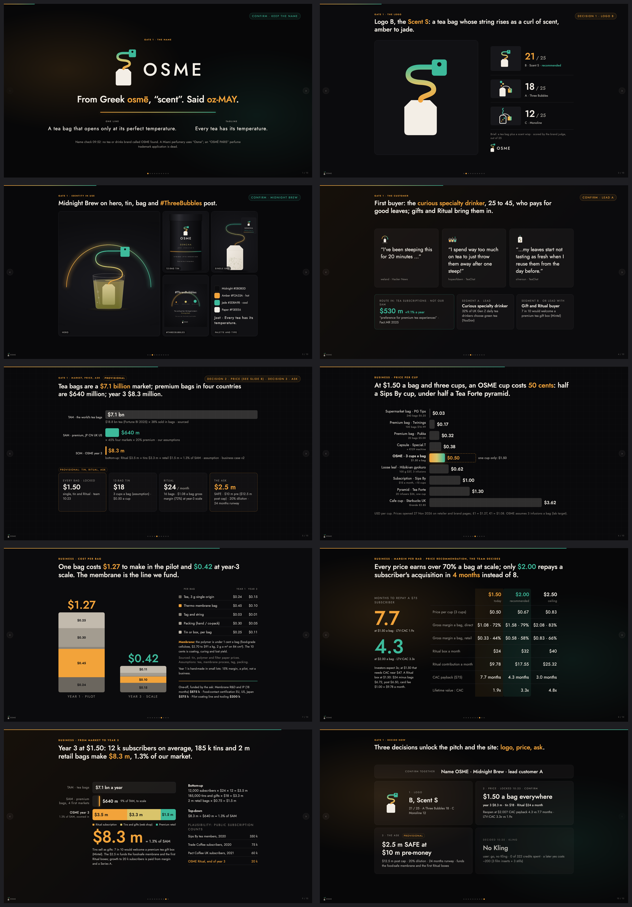
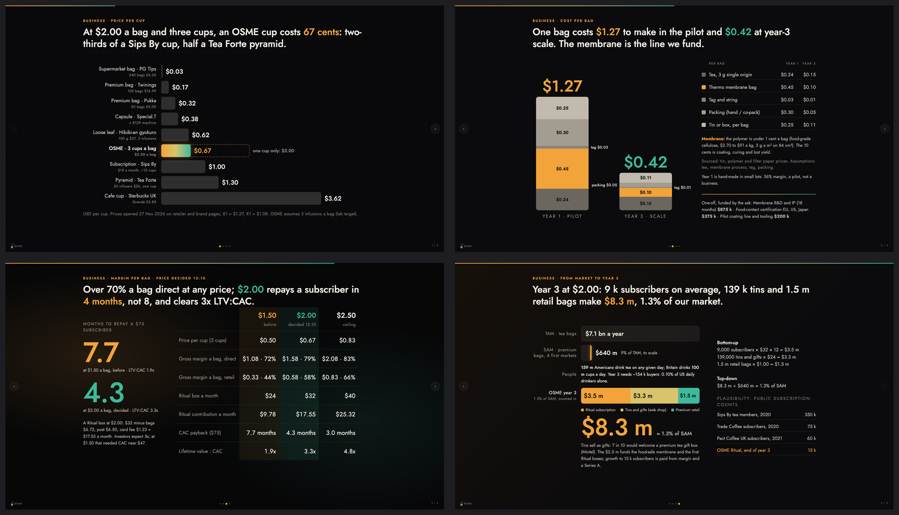
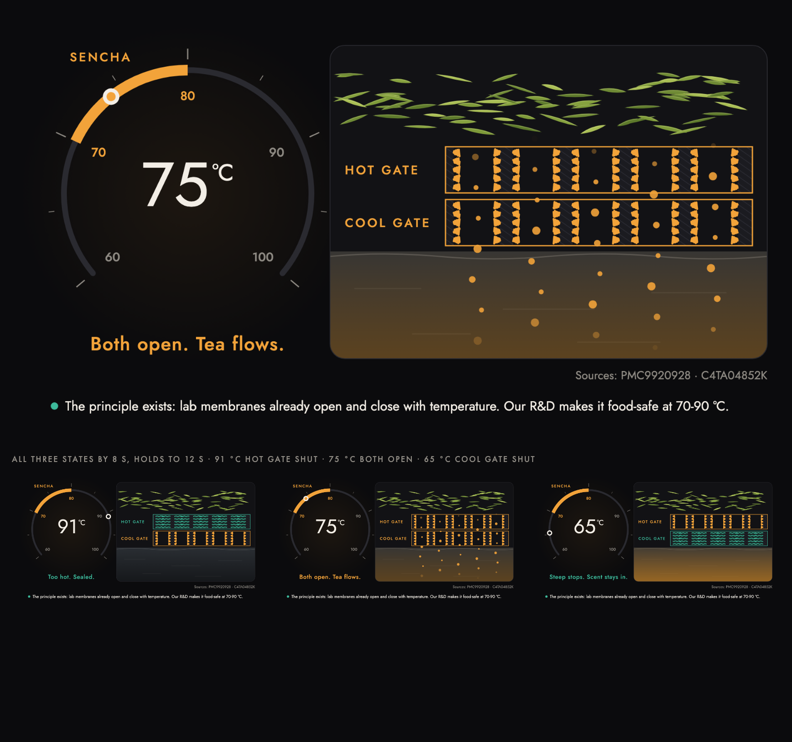
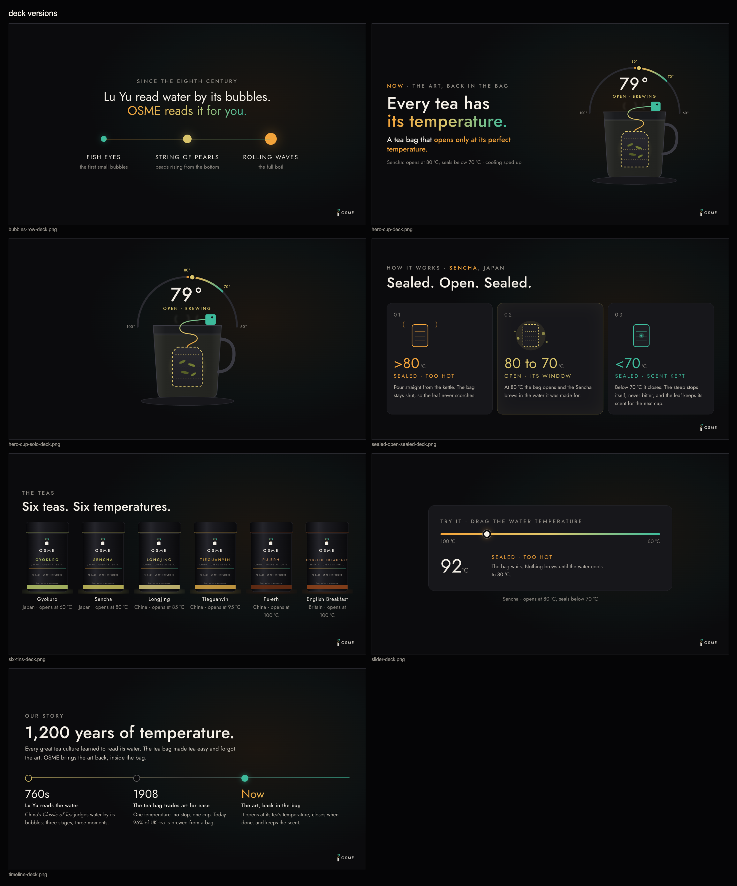
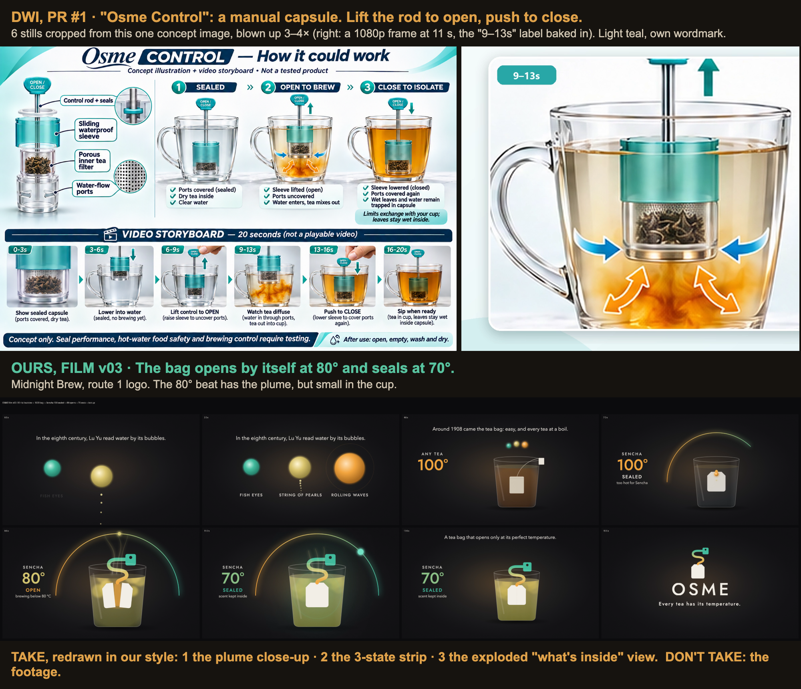

# Table 5 · Waterproof Tea Bags

**Sell the unsellable.** Build 10:25 to 13:30 · pitches from 13:35 · done 14:30.
Everyone drives at least once.

<!-- LIVE:START -->
## Live status · 04:28 · 9 h 01 to hand-in

**Now:** "Handed in: the live site is verified at 13:18. Start at handin.html: all five hand-ins on one page."

| | Topic | Status | Latest preview |
|---|---|---|---|
| 🎨 | Brand & logo | 🟢 done · judge 4/5 · 12:19 |  |
| 🚦 | Gate 1 deck | 🟡 working · judge 4/5 · 10:53 |  |
| 📈 | Business case | 🟢 done · judge 4.5/5 · 12:22 |  |
| 🍵 | Product demo | 🟡 working · judge 4/5 · 12:35 |  |
| 🎤 | Pitch deck | 🟢 done · judge 24/30 · 12:59 |  |
| 🌐 | Site | 🟡 working · 13:15 |  |
| 🎬 | Video | 🟢 done · 12:43 |  |

**Waiting on the team:** Speakers A to D?
<!-- LIVE:END -->

## Five things to hand in by 13:30

**Start here: [https://mendixmau.github.io/table5-waterproof-tea/handin.html](https://mendixmau.github.io/table5-waterproof-tea/handin.html)**, all five on one page. Live site: [https://mendixmau.github.io/table5-waterproof-tea/](https://mendixmau.github.io/table5-waterproof-tea/)

| # | Hand-in | What the brief asks | Open it (live) | In this repo |
|---|---|---|---|---|
| 1 | Brand | Name, logo, one line | [Brand board](https://mendixmau.github.io/table5-waterproof-tea/brand.html) | `brand/identity/board.html`, `facts.md` |
| 2 | Customer | Who buys it, and where we found them | [Customer evidence](https://mendixmau.github.io/table5-waterproof-tea/customer.html) | `shared/business/customer-evidence.html`, `truth/customers-market.md` |
| 3 | Product | Works today, on one laptop | [Live demo](https://mendixmau.github.io/table5-waterproof-tea/demo.html) · [How the membrane works](https://mendixmau.github.io/table5-waterproof-tea/membrane.html) · [v2 in 3D](https://mendixmau.github.io/table5-waterproof-tea/capsule-3d.html) | `product/index.html`, `shared/product/membrane-how.html` |
| 4 | Site | What it does, who it is for, the price | [The site](https://mendixmau.github.io/table5-waterproof-tea/) | `docs/` (GitHub Pages) |
| 5 | Pitch | 3 minutes, product running, 8 slides | [Pitch deck](https://mendixmau.github.io/table5-waterproof-tea/pitch.html) (Space starts the film) | `deck/pitch.html`, `deck/script.md`, `video/osme-film-v04-vo.mp4` |

Eight slides: 1 company · 2 problem · 3 solution · 4 customer evidence · 5 market · 6 business · 7 competition · 8 the ask.

## How we work

Lead thread → 5 topic threads → each runs **build → validate → judge** → a preview lands in `gallery/` at least every 10 minutes → the team decides at the gates.

| Topic | Output |
|---|---|
| 🎨 Brand & logo | `brand/identity/`, `brand/assets/` |
| 🍵 Product demo | `product/index.html` |
| 🎤 Presentation: Gate 1 deck, then the pitch | `deck/gate1.html`, `deck/pitch.html` |
| 🌐 Site | `docs/index.html` → GitHub Pages |
| 🎬 Video | `video/` |
| 📈 Business case | `truth/business-case.md`, `deck/business.html` |

**Alignment:** every thread reads `facts.md` (names, numbers), `brand/identity/tokens.css` (colours, type) and the logo files under fixed names, so one change there reaches deck, site, product and video. Every judge checks against `facts.md`.

## Rules

- **`facts.md` is the single source of truth.** Name, price, numbers: change them there first, never only on a slide.
- Every customer or market claim needs a source link in `truth/`. No source, no claim.
- Every HTML file is self-contained (images and CSS embedded) so it runs offline.
- Pull before you push. Work in your own pod's folder.

## Gates

| Time | Gate |
|---|---|
| 10:40 | ✅ **Gate 1 · brand, logo, market.** Reviewed in `deck/gate1.html`. |
| 11:45 | First pitch read-through with the team (4 speakers, product running) |
| 12:00 | Judge pass 1 |
| 12:45 | Judge pass 2 and full run-through |
| 13:15 | Freeze, rehearse twice |
| 13:30 | Hand in |
