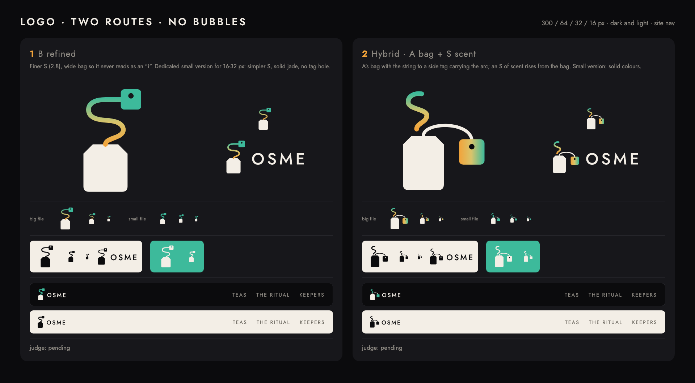
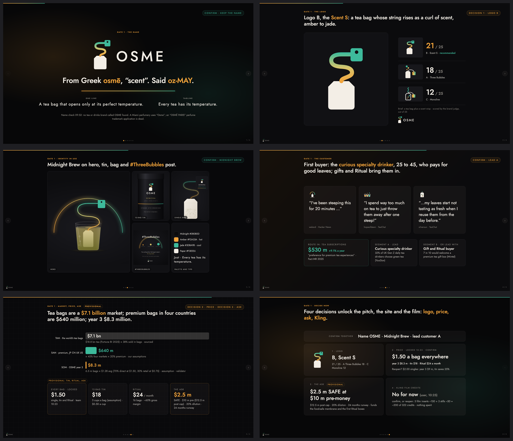
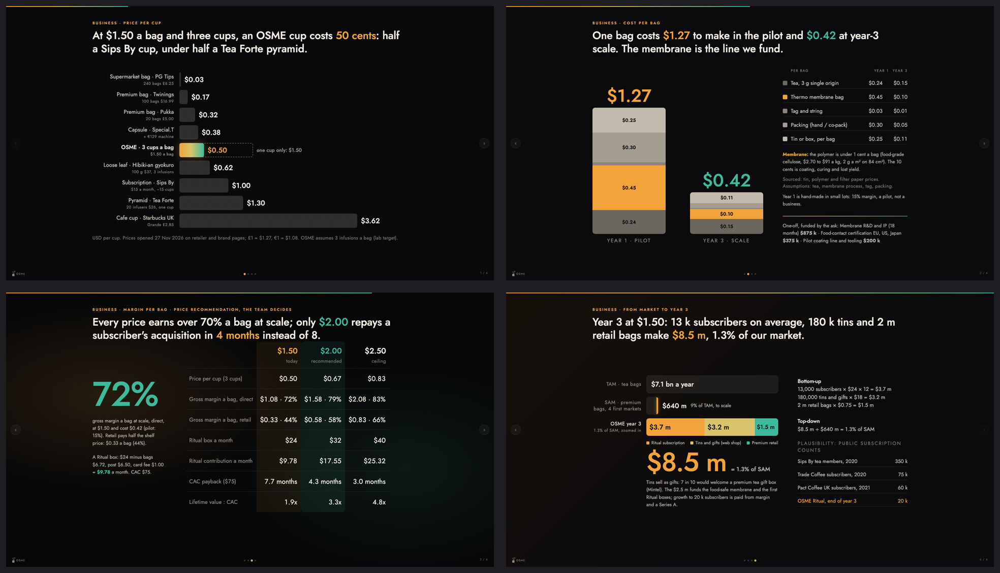
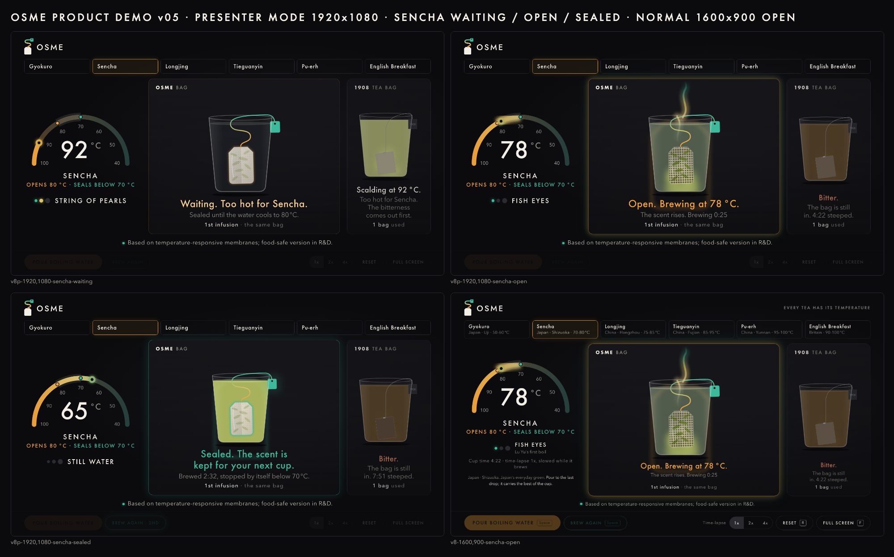
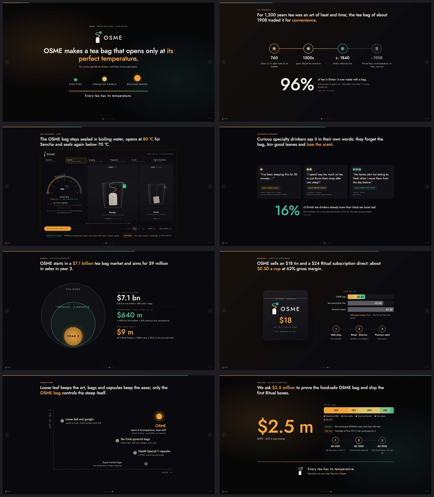
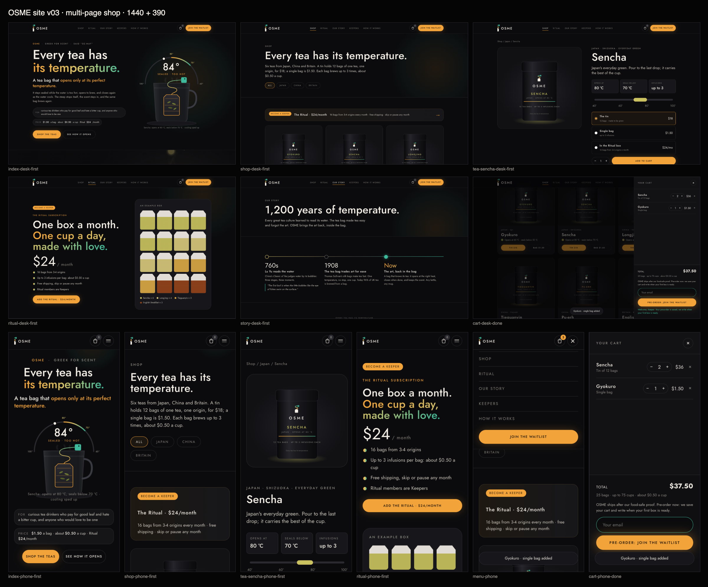
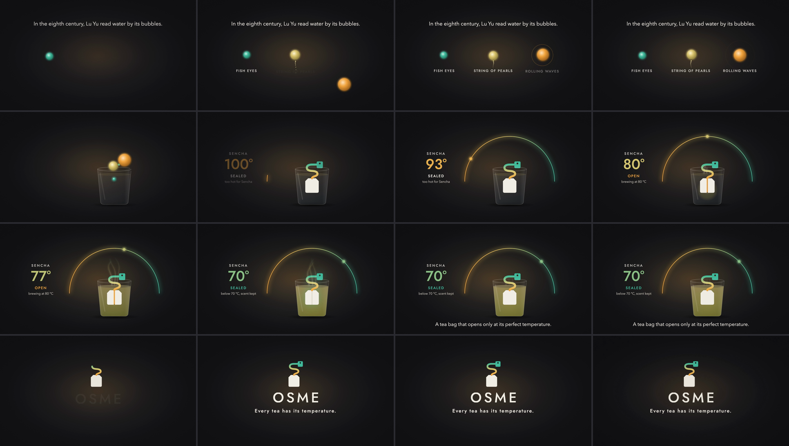

# Table 5 · Waterproof Tea Bags

**Sell the unsellable.** Build 10:25 to 13:30 · pitches from 13:35 · done 14:30.
Everyone drives at least once.

<!-- LIVE:START -->
## Live status · 10:46 · 2 h 43 to hand-in

**Now:** Gate 1 deck is open: name, logo, logo in use, customer, market, decisions. Logo routes and business v2 land by 11:05.

| | Topic | Status | Latest preview |
|---|---|---|---|
| 🎨 | Brand & logo | 🟡 working · judge 21/25 · 10:37 |  |
| 🚦 | Gate 1 deck | 🟡 working · judge 4/5 · 10:38 |  |
| 📈 | Business case | 🟡 working · judge 3.0/5 · 10:46 |  |
| 🍵 | Product demo | 🟡 working · judge 4/5 · 10:42 |  |
| 🎤 | Pitch deck | ⚪ on hold · 10:18 |  |
| 🌐 | Site | 🟡 working · 10:46 |  |
| 🎬 | Video | 🟡 working · 10:41 |  |

**Waiting on the team:** Logo: B finer, or A's bag + S? · Bubbles: logo only, or everywhere? · Waitlist: Google Form, Formspree or FormSubmit? · Price: stay $1.50 or go premium?
<!-- LIVE:END -->

## Five things to hand in by 13:30

| # | Hand-in | Definition | Lives in |
|---|---|---|---|
| 1 | Brand | Name, logo, one line | `facts.md`, `brand/identity/` |
| 2 | Customer | Who buys it, with evidence of where we found them | `truth/` |
| 3 | Product | Works today, on one laptop | `product/` |
| 4 | Site | What it does, who it is for, the price | `docs/` → GitHub Pages |
| 5 | Pitch | 3 minutes, product running, 8 slides | `deck/` |

Eight slides: 1 company · 2 problem · 3 solution · 4 customer evidence · 5 market · 6 business · 7 competition · 8 the ask.

## How we work

Lead thread → 5 topic threads → each runs **build → validate → judge** → a preview lands in `gallery/` at least every 10 minutes → the team decides at the gates.

| Topic | Output |
|---|---|
| 🎨 Brand & logo | `brand/identity/`, `brand/assets/` |
| 🍵 Product demo | `product/index.html` |
| 🎤 Presentation: Gate 1 deck, then the pitch | `deck/gate1.html`, `deck/pitch.html` |
| 🌐 Site | `docs/index.html` → GitHub Pages |
| 🎬 Video | `video/` |

**Alignment:** every thread reads `facts.md` (names, numbers), `brand/identity/tokens.css` (colours, type) and the logo files under fixed names, so one change there reaches deck, site, product and video. Every judge checks against `facts.md`.

## Rules

- **`facts.md` is the single source of truth.** Name, price, numbers: change them there first, never only on a slide.
- Every customer or market claim needs a source link in `truth/`. No source, no claim.
- Every HTML file is self-contained (images and CSS embedded) so it runs offline.
- Pull before you push. Work in your own pod's folder.

## Gates

| Time | Gate |
|---|---|
| 10:40 | **Gate 1 · brand, logo, market.** The team reviews `deck/gate1.html`. Site, video and pitch wait for it. |
| 11:00 | Build on the approved brand: product, site, video, pitch |
| 12:00 | Judge pass 1 |
| 12:45 | Judge pass 2 and full run-through |
| 13:15 | Freeze, rehearse twice |
| 13:30 | Hand in |
